# Scalable ERP — Complete Data Flow Diagrams (Start → End)

> **Purpose:** End-to-end data flow reference for every major path in the system — what gets created, what gets updated, and in what order.  
> **Companion docs:** [SYSTEM_FUNCTIONALITY_OVERVIEW.md](./SYSTEM_FUNCTIONALITY_OVERVIEW.md) · [ERP_FULL_UAT_GUIDE.md](./ERP_FULL_UAT_GUIDE.md) · [procurement-to-inventory-flow.md](./api/procurement-to-inventory-flow.md) · [production-to-stock-flow.md](./api/production-to-stock-flow.md)

## Visual diagram viewer (recommended)

Open the **interactive flow diagram viewer** in your browser — diagrams render as graphics, not raw text:

| How to open | URL / path |
|-------------|------------|
| **In browser (dev server)** | [http://localhost:3000/system-data-flows.html](http://localhost:3000/system-data-flows.html) |
| **From repo file** | Open [data-flow-viewer.html](./data-flow-viewer.html) in Chrome / Edge / Firefox |

Use the left navigation to switch between 11 visual flows (master E2E, auth, master data, procurement, production, distribution, sales, finance, HR, stock ledger).

> **GitHub note:** Mermaid blocks below also render as diagrams in GitHub’s markdown preview. For the best experience locally, use the HTML viewer above.

---

## How to read these diagrams

| Symbol | Meaning |
|--------|---------|
| **Rectangle** | Module action or document created |
| **Diamond** | Decision / approval gate |
| **Cylinder** | Database record or stock balance updated |
| **Dashed arrow** | Optional path (finance, QC, etc.) |
| **Solid arrow** | Required sequential step |

Data always flows **tenant-scoped** (isolated PostgreSQL per organization). Every API call carries JWT + tenant context → `PrismaService` routes to the correct tenant DB.

---

## 1. Master end-to-end flow (whole business)

This is the **full lifecycle** from empty tenant to cash in bank — every major data path on one map.

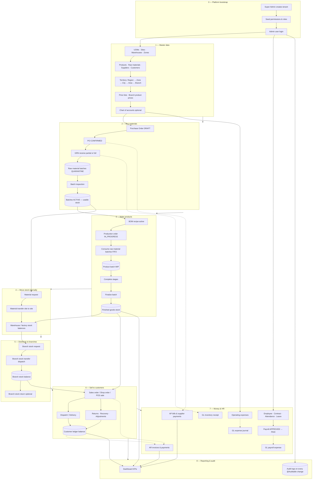

---

## 2. Platform & authentication data flow

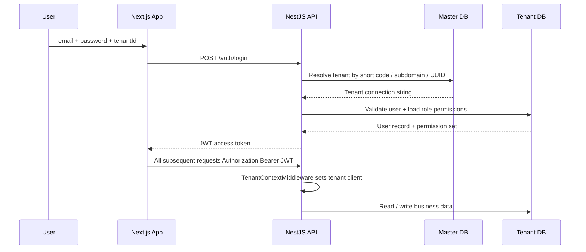

**Data created:** Session token (client-side). No business documents until master data is set up.

---

## 3. Master data setup flow (required before operations)

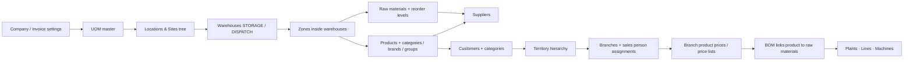

**Stock impact:** None — master data only. Stock counters start at zero until GRN, production finalize, or manual adjustment.

---

## 4. Procurement → inventory data flow

### 4.1 Happy path

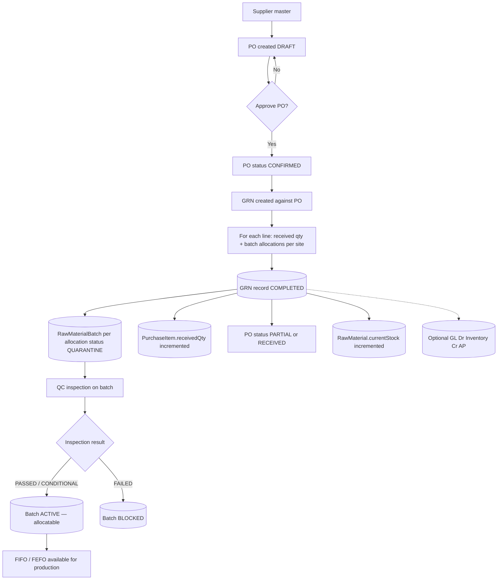

### 4.2 Purchase return path

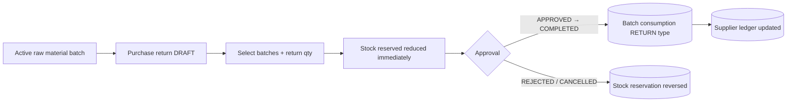

**Key data entities:** `PurchaseOrder` → `PurchaseOrderItem` → `GRN` → `GRNItem` → `RawMaterialBatch` → `StockLedger` / `currentStock`

---

## 5. Production → finished goods data flow

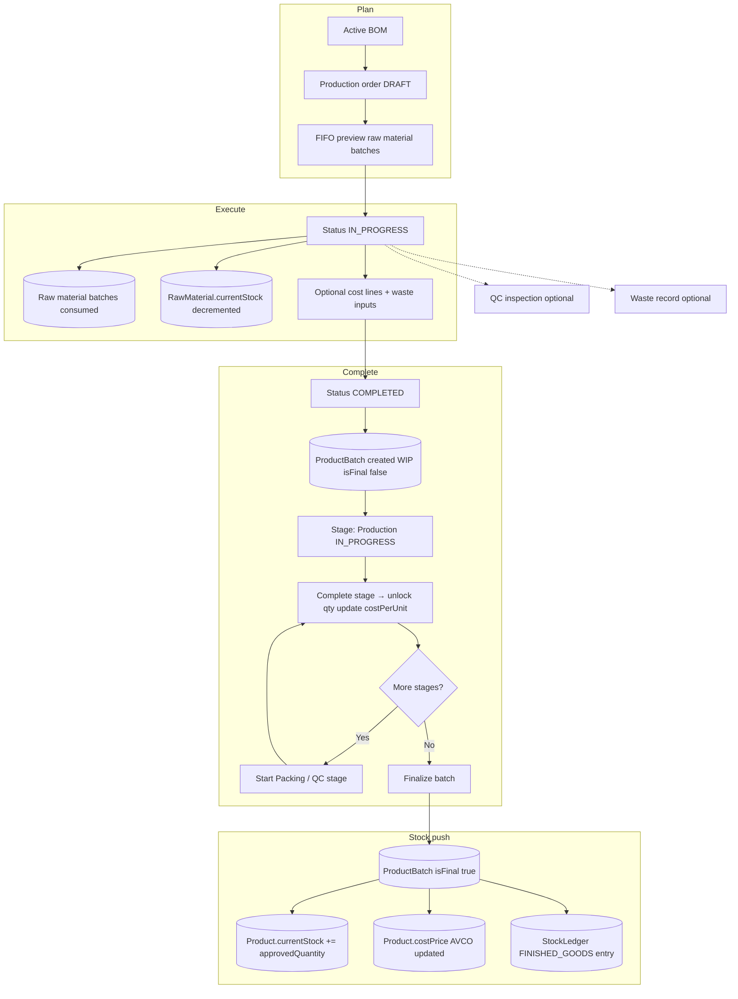

**Work orders** follow a parallel shop-floor path: `WorkOrder` scheduled → in progress → completed, linked to production context.

---

## 6. Internal material movement data flow

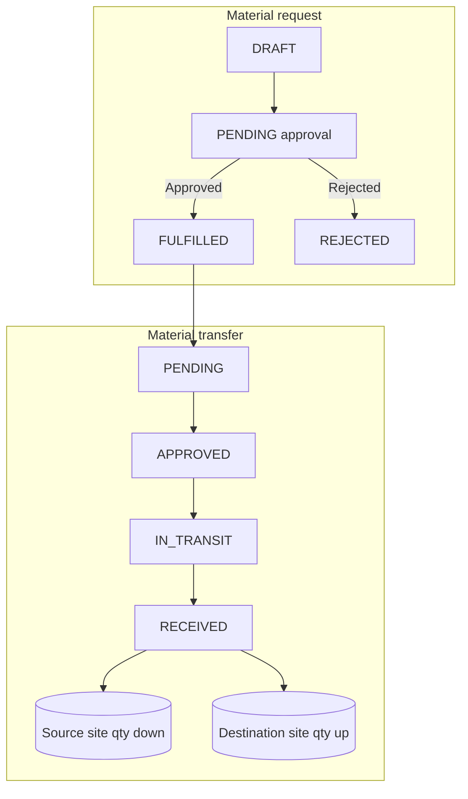

**GL note:** Internal transfers do **not** post to GL (same inventory value, different location). See [GL_POSTING_EXCEPTIONS.md](./GL_POSTING_EXCEPTIONS.md).

---

## 7. Distribution: factory → branch → customer

### 7.1 Branch replenishment

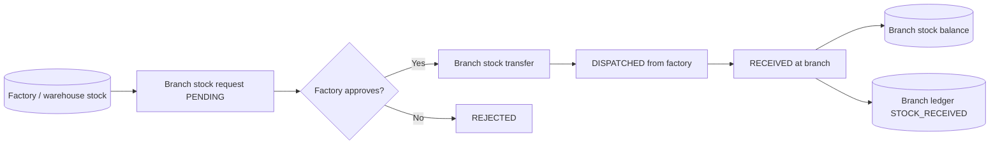

### 7.2 Branch return to factory

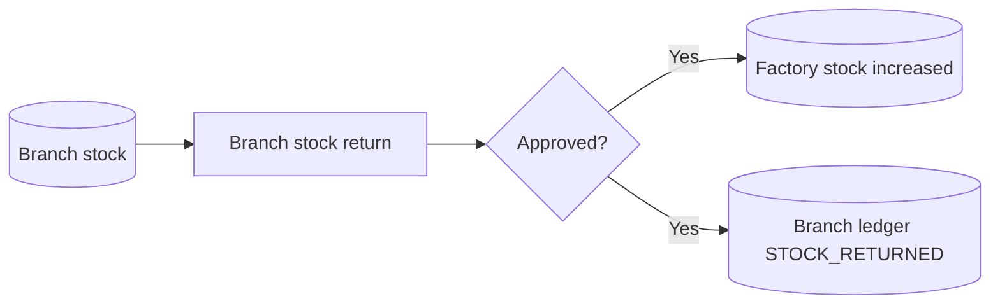

### 7.3 Customer / shop channel

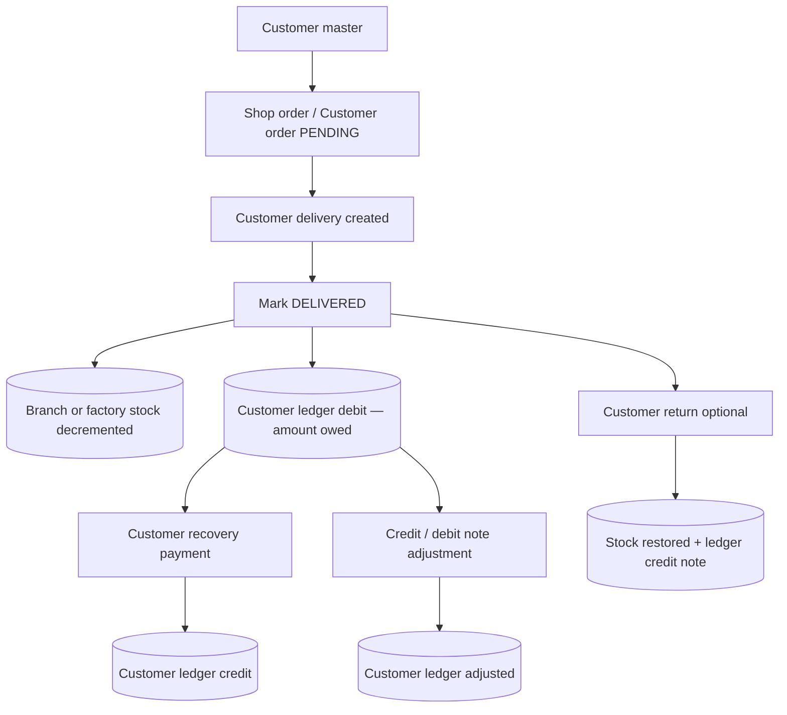

---

## 8. Direct sales & POS data flow

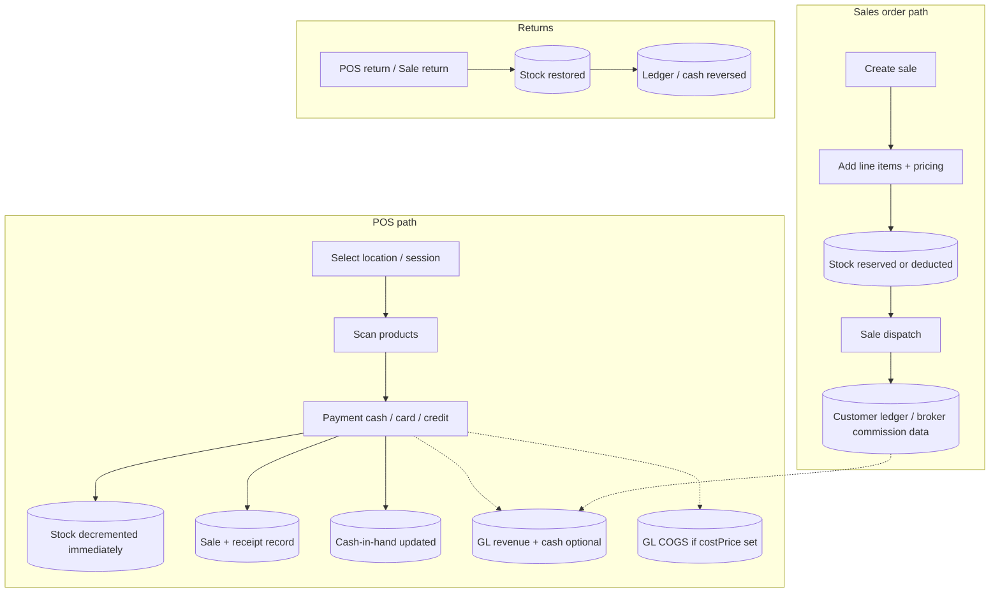

---

## 9. Financial / GL data flow (cross-cutting)

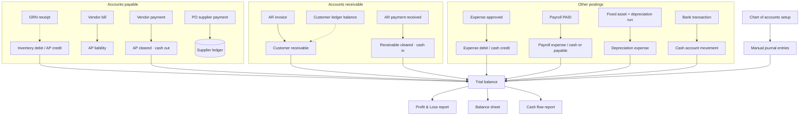

**Important:** Dashed lines = best-effort or optional depending on COA configuration. See [GL_POSTING_EXCEPTIONS.md](./GL_POSTING_EXCEPTIONS.md) for modules that never auto-post.

---

## 10. HR & payroll data flow

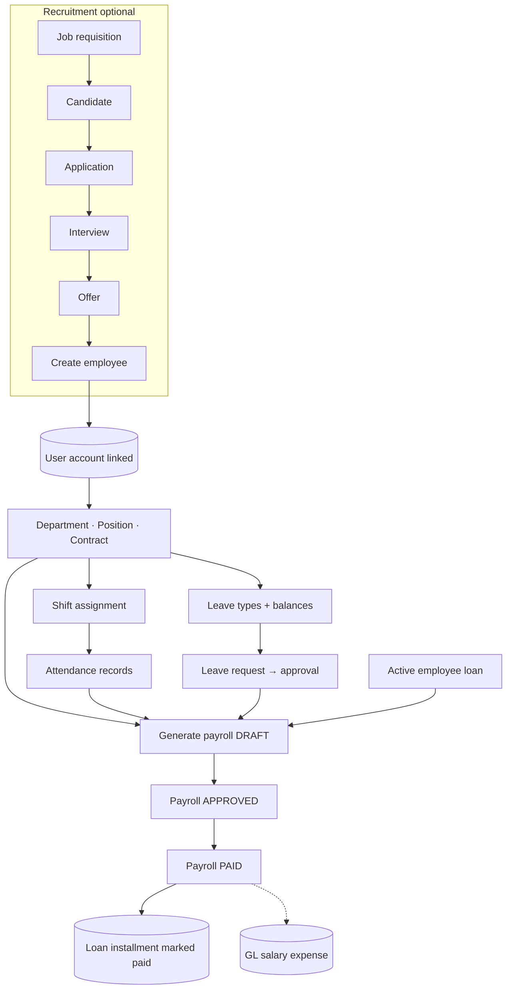

---

## 11. Stock ledger — how inventory numbers move

All quantity changes ultimately touch one or more of these stores:

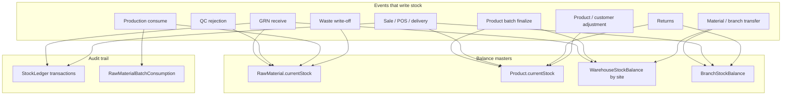

---

## 12. Quality control data flow

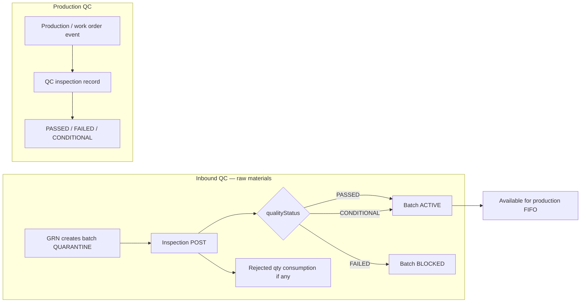

---

## 13. Audit & permissions data flow

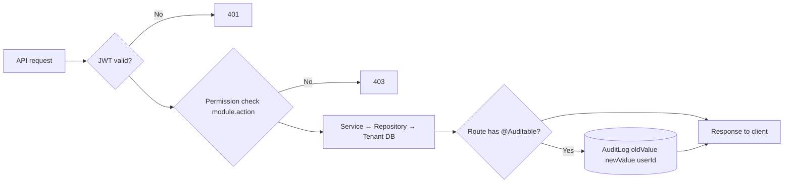

---

## 14. Recommended operational sequence (data dependency order)

| Step | Action | Depends on | Creates / updates |
|------|--------|------------|-------------------|
| 1 | Provision tenant | Super Admin | Master DB tenant row |
| 2 | Seed permissions & roles | Step 1 | Tenant permissions + roles |
| 3 | Create admin via HR employee | Step 2 | User + employee |
| 4 | UOMs, sites, warehouses | Step 3 | Location master |
| 5 | Products, raw materials, suppliers | Step 4 | Item master |
| 6 | Customers, territory, branches | Step 5 | Sales master |
| 7 | Chart of accounts | Step 3 | GL accounts |
| 8 | BOM | Steps 5 | Recipe |
| 9 | Purchase order → GRN | Steps 5, 4 | Raw material stock |
| 10 | Batch QC | Step 9 | Usable batches |
| 11 | Production order | Steps 8, 10 | WIP batches |
| 12 | Finalize product batch | Step 11 | Finished goods stock |
| 13 | Branch stock transfer | Steps 6, 12 | Branch stock |
| 14 | Sale / POS / delivery | Steps 6, 12 or 13 | Customer ledger, revenue |
| 15 | AR payment / recovery | Step 14 | Cash in, AR cleared |
| 16 | Payroll | HR master | Salary paid, loan deducted |

---

## 15. Entity relationship summary

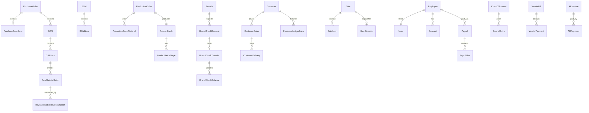

---

## 16. Document index

| Flow | Detailed API doc |
|------|------------------|
| PO → GRN → batches | [procurement-to-inventory-flow.md](./api/procurement-to-inventory-flow.md) |
| Production → FG stock | [production-to-stock-flow.md](./api/production-to-stock-flow.md) |
| Purchase orders | [purchase-orders-api.md](./api/purchase-orders-api.md) |
| GRN | [grn-api.md](./api/grn-api.md) |
| Sales | [sales-api.md](./api/sales-api.md) |
| HR payroll | [hr/payroll-api.md](./api/hr/payroll-api.md) |
| GL exceptions | [GL_POSTING_EXCEPTIONS.md](./GL_POSTING_EXCEPTIONS.md) |
| Full UAT walkthrough | [ERP_FULL_UAT_GUIDE.md](./ERP_FULL_UAT_GUIDE.md) |

---

*Last updated: September 2026 — aligned with tenant modules in `backend/src/app.module.ts` and sidebar navigation.*
