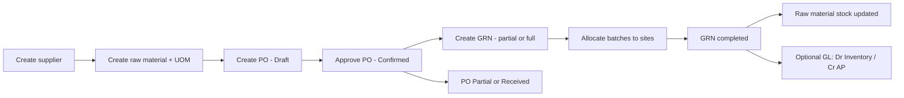
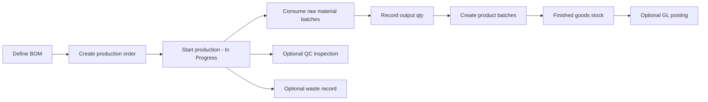
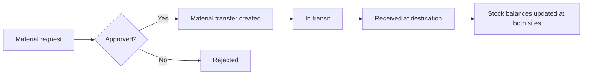
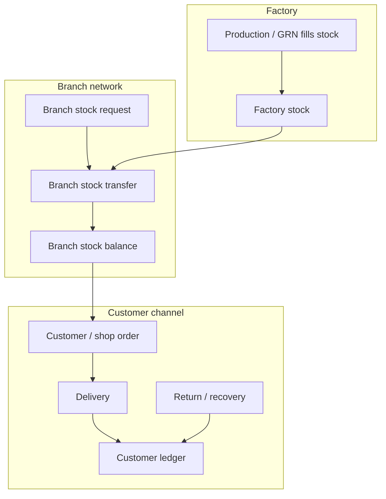
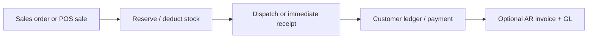
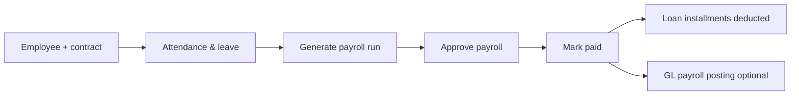
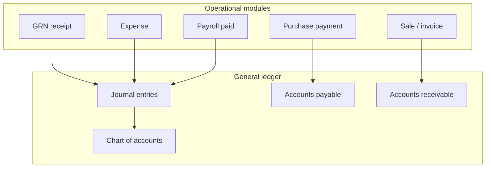

# Scalable ERP — System Functionality Overview

> **Purpose:** Single reference for what the system does, how modules relate, and the main business flows.  
> **Audience:** Product owners, QA, implementers, and developers onboarding to the codebase.

**Related docs (already in this repo):**

| Document | What it covers |
|----------|----------------|
| [ERP_FULL_UAT_GUIDE.md](./ERP_FULL_UAT_GUIDE.md) | Step-by-step UAT from zero to sign-off |
| [USER_ROLES_AND_PERMISSIONS_GUIDE.md](./USER_ROLES_AND_PERMISSIONS_GUIDE.md) | Roles, permissions, seeding |
| [ROLE_BASED_UAT_GUIDE.md](./ROLE_BASED_UAT_GUIDE.md) | Role-specific test scenarios |
| [docs/api/](./api/) | Per-module API references |
| [procurement-to-inventory-flow.md](./api/procurement-to-inventory-flow.md) | PO → GRN → stock |
| [production-to-stock-flow.md](./api/production-to-stock-flow.md) | Production → finished goods |
| **[DATA_FLOW_DIAGRAMS.md](./DATA_FLOW_DIAGRAMS.md)** | **Complete start-to-end data flow charts (all modules)** |
| **[data-flow-viewer.html](./data-flow-viewer.html)** | **Interactive visual diagram viewer (open in browser)** |

API docs and UAT guides are detailed but fragmented by module. Use **data-flow-viewer.html** or **DATA_FLOW_DIAGRAMS.md** for the full visual map of how data moves through the system.

---

## 1. Platform architecture

```mermaid
flowchart TB
  subgraph clients [Clients]
    Web[Next.js Web App]
    POS[POS Terminal]
    SA[Super Admin Portal]
  end

  subgraph backend [NestJS Backend]
    API[REST API + Guards]
    Prisma[PrismaService - tenant routing]
    Audit[@Auditable interceptor]
  end

  subgraph data [Data]
    Master[(Master DB - tenants)]
    Tenant[(Tenant DB - per org)]
  end

  Web --> API
  POS --> API
  SA --> API
  API --> Prisma
  Prisma --> Master
  Prisma --> Tenant
  API --> Audit
```

**Multi-tenancy:** Each organization (tenant) has an isolated PostgreSQL schema/database. Login requires **email + password + tenant ID**. Super Admin manages tenants, subscriptions, and payments outside tenant scope.

**Authorization:** Role-based permissions (`module.action`) enforced on every route. See permissions guide for seeding and assignment.

---

## 2. Module map (by sidebar area)

### 2.1 Overview

| Module | Route | Functionality |
|--------|-------|---------------|
| Business Dashboard | `/dashboard` | Revenue, profit, stock value, PO/production/GRN/BOM pipelines, supplier/customer rankings, inventory health |
| Factory Dashboard (DMD) | `/dashboard/factory` | Production-centric KPIs: output, waste, quality pass rate |

### 2.2 Master data

| Module | Functionality |
|--------|---------------|
| **Products** | Finished/semi-finished goods, categories, brands, groups, UOMs, bulk import |
| **Raw materials** | Ingredients/packaging, batch tracking, expiry |
| **Locations** | Generic location master |
| **Sites** | Warehouses, zones, hierarchical site tree |
| **Suppliers** | Vendor master, supplier ledger (purchases, payments, returns) |

### 2.3 Warehouse management

| Module | Functionality |
|--------|---------------|
| **Warehouses** | Storage vs dispatch warehouses, capacity |
| **Zones** | Sub-locations inside warehouses |
| **Warehouse stock** | Balances by warehouse/zone, transactions, capacity alerts |
| **Batches** | Raw material batch inventory (quarantine, active, consumed, expired) |
| **Stock / reorder** | Product stock balances, reorder alerts |

### 2.4 Procurement

| Module | Functionality |
|--------|---------------|
| **Purchase orders** | Draft → Confirmed → Partial → Received → Cancelled; line items, approvals, payments |
| **Purchase returns** | Return goods to supplier against PO/GRN |

### 2.5 Material management (factory floor)

| Module | Functionality |
|--------|---------------|
| **GRN (Goods Receipt)** | Receive PO lines (full or partial), batch allocation to sites, inspection workflow |
| **Material requests** | Internal request for raw materials (approval → fulfillment) |
| **Material transfers** | Move stock between sites/warehouses (pending → in transit → received) |

### 2.6 Production

| Module | Functionality |
|--------|---------------|
| **Production orders** | Plan and run manufacturing; consume raw materials, produce finished goods |
| **Plants / lines / machines** | Physical production structure |
| **Work orders** | Shop-floor tasks scheduled against production |
| **BOM** | Bill of materials (recipes linking product ↔ raw materials) |
| **Product batches** | Finished/WIP batch tracking after production |

### 2.7 Quality & waste

| Module | Functionality |
|--------|---------------|
| **Quality control** | Inspections on receipts/production (pending → passed/failed/conditional) |
| **Waste management** | Record and categorize production waste |

### 2.8 Costing & factory reports

| Module | Functionality |
|--------|---------------|
| **Costing** | Cost dashboard, profitability |
| **Factory reports** | Production, material, quality, waste, warehouse reports |

### 2.9 Sales & distribution

| Module | Functionality |
|--------|---------------|
| **Sales orders** | Direct sales, dispatches, returns |
| **Shop orders / deliveries / returns** | Customer order-to-cash for retail/shop channel |
| **Shop recovery & adjustments** | Payment recovery, credit/debit notes, product adjustments |
| **Customer ledger** | Running balance per customer |
| **Branch stock** | Stock held at distribution branches |
| **Branch requests / transfers / returns** | Branch replenishment from factory |
| **Factory stock** | Central dispatch stock view for branches |
| **Pricing** | Price lists, branch product prices, bonus groups/schemes |
| **Territory & sales assignments** | Regions, zones, cities, areas, branches, sales person mapping |
| **Employee cash** | Field cash ledger and transfers |
| **Customers / brokers / transporters** | Party masters |

### 2.10 Point of sale (POS)

| Module | Route | Functionality |
|--------|-------|---------------|
| **POS** | `/pos` | Counter sales, held invoices, returns, daily reports, credit sales |

### 2.11 Profit analytics

| Module | Functionality |
|--------|---------------|
| **Profit** | Overview, daily/monthly, by product, by plant |

### 2.12 Human resources

| Module | Functionality |
|--------|---------------|
| **Employees** | Master record; creates linked user account |
| **Departments / positions / org units / grades** | Org structure |
| **Contracts** | Employment terms, salary revisions |
| **Attendance & shifts** | Time tracking |
| **Leave & holidays** | Leave types, requests, approvals, balances |
| **Payroll** | Generate → approve → pay; integrates loans & attendance |
| **Loans** | Employee loans with installment deductions via payroll |
| **Recruitment** | Job requisitions, candidates, applications, interviews, offers |

### 2.13 Financial management

| Module | Functionality |
|--------|---------------|
| **Chart of accounts** | GL account hierarchy |
| **Journal entries** | Manual balanced postings |
| **Accounts payable** | Vendor bills, payments, aging |
| **Accounts receivable** | Customer invoices, payments, aging |
| **Cash / bank** | Bank accounts and transactions |
| **Fixed assets & depreciation** | Asset register, depreciation runs |
| **Budgeting** | Budgets and variance |
| **Financial reports** | P&L, balance sheet, cash flow |
| **Expenses** | Operating expense capture and reports |
| **Cash in hand** | Petty cash tracking |

### 2.14 System

| Module | Functionality |
|--------|---------------|
| **Audit logs** | Automatic change history via `@Auditable` routes |
| **Users** | Tenant user administration |
| **Settings** | Account settings, roles & permissions |
| **Super Admin** | Tenant provisioning, subscriptions, payments (separate portal) |

---

## 3. Core business flows

### 3.1 Procurement → inventory (buy stock in)



**Key rules:** GRN requires a confirmed (non-draft) PO. Multiple GRNs per PO allowed until fully received. Received qty cannot exceed remaining PO qty per line.

### 3.2 Production → finished goods



### 3.3 Internal material movement



### 3.4 Distribution sales (factory → branch → customer)



### 3.5 Direct sales & POS



### 3.6 HR → payroll



### 3.7 Finance integration (cross-cutting)



> GL posting is **best-effort** on some operational events (e.g. GRN) when inventory/AP accounts are not configured — stock still updates; finance may need manual journals until COA is set up. See [GL_POSTING_EXCEPTIONS.md](./GL_POSTING_EXCEPTIONS.md).

---

## 4. Status lifecycles (quick reference)

| Entity | Typical statuses |
|--------|------------------|
| Purchase order | DRAFT → CONFIRMED → PARTIAL → RECEIVED / CANCELLED |
| GRN | PENDING → INSPECTING → APPROVED / REJECTED → COMPLETED |
| Material request | DRAFT → PENDING → APPROVED / REJECTED → FULFILLED / CANCELLED |
| Material transfer | PENDING → APPROVED → IN_TRANSIT → RECEIVED / CANCELLED |
| Production order | DRAFT → IN_PROGRESS → COMPLETED / CANCELLED |
| Work order | DRAFT → SCHEDULED → IN_PROGRESS → COMPLETED / CANCELLED |
| BOM | DRAFT → ACTIVE → INACTIVE |
| Branch stock request | PENDING → APPROVED / REJECTED |
| Branch stock transfer | PENDING → DISPATCHED → RECEIVED / CANCELLED |
| Payroll | DRAFT → APPROVED → PAID |
| QC inspection | PENDING → PASSED / FAILED / CONDITIONAL |

---

## 5. Recommended setup order (new tenant)

1. **Tenant & admin user** (Super Admin → provision tenant)
2. **Roles & permissions** (seed + assign)
3. **UOMs, sites, warehouses, zones**
4. **Products, raw materials, suppliers, customers**
5. **Chart of accounts** (if using finance)
6. **Branches & territory** (if using distribution)
7. **Operational flows** in order: PO → GRN → production → sales/POS

Full hands-on sequence: [ERP_FULL_UAT_GUIDE.md](./ERP_FULL_UAT_GUIDE.md).

---

## 6. Technology stack

| Layer | Stack |
|-------|-------|
| Frontend | Next.js (App Router), React, TanStack Query, Tailwind |
| Backend | NestJS, Prisma, PostgreSQL |
| Auth | JWT + tenant context middleware |
| Audit | Interceptor on `@Auditable` controller routes |

---

## 7. Document maintenance

When adding a new sidebar module:

1. Add backend module + permissions file
2. Add API doc under `docs/api/`
3. Update this file’s module table and flows if a new cross-module path exists
4. Add UAT steps to `ERP_FULL_UAT_GUIDE.md` if user-facing

---

*Last updated: September 2026 — reflects modules registered in `app.module.ts` and sidebar navigation.*
